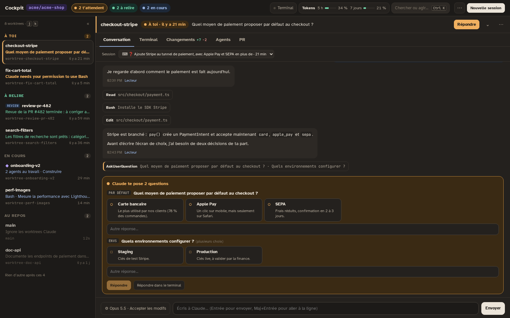
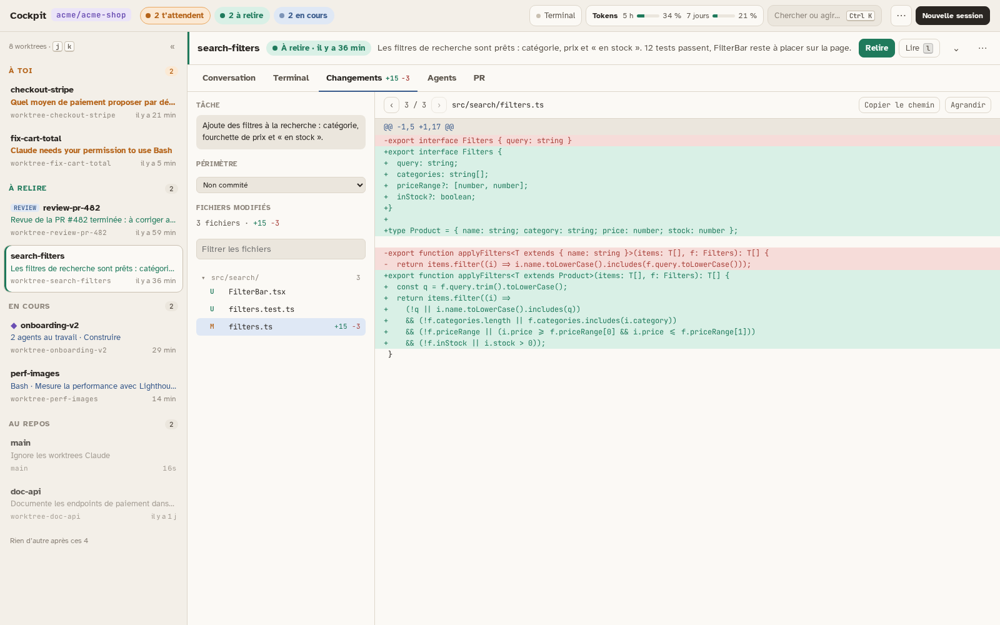
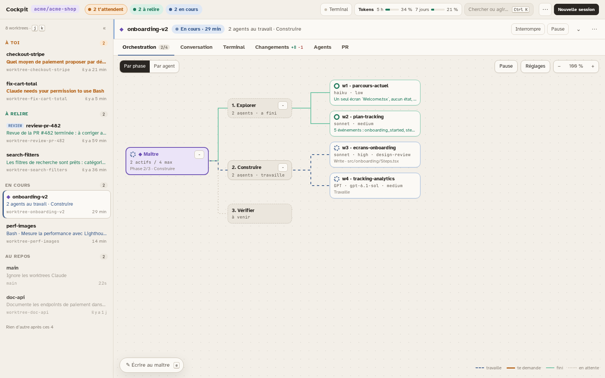
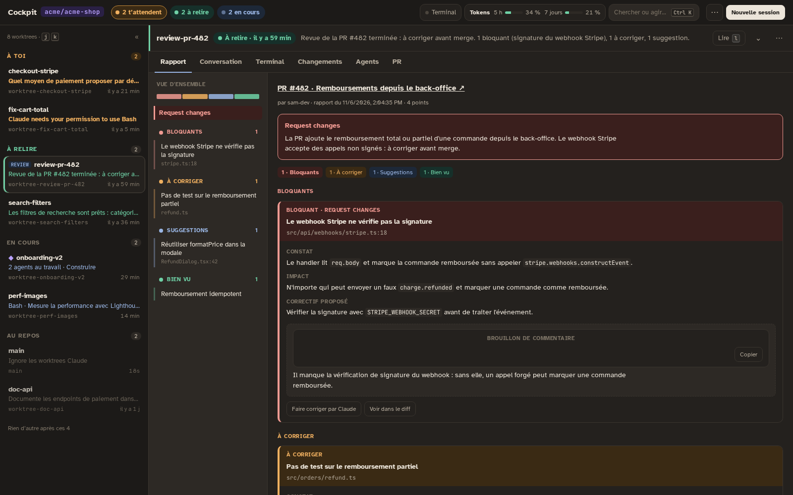

# Cockpit

A web cockpit to run many Claude Code sessions in parallel, one per git worktree, and always know which one needs you.



| Review the changes | Orchestrate agents | Read a PR review |
|---|---|---|
|  |  |  |

- **Attention queue**: sessions sorted by what they expect from you: answer, review, or nothing.
- **Answer from the page**: questions, permissions and messages, without hunting for the right terminal.
- **Orchestration**: a master splits a task into phases and runs agents, Claude or GPT.
- **PR reviews**: a review session writes a report in colored blocks.

New to it? Take the **[guided tour](docs/visite-guidee.md)** (10 minutes, in French).

## Get started

You need **Node 20+**, **git**, **tmux** and **Claude Code** (signed in). `start.sh` installs tmux itself only with `apt`; elsewhere install it first. For PRs (checks, "Pousser et ouvrir la PR", reviews), sign in the GitHub CLI: `gh auth login`.

```bash
git clone https://github.com/lucasBoisgard/Cockpit ~/.claude/cockpit
~/.claude/cockpit/start.sh
```

The cockpit must live in `~/.claude/cockpit`: hooks, status line and skills are only installed from there. Open the URL that `start.sh` prints (`http://localhost:8052/?token=…`).

`start.sh` adds the cockpit's hooks to `~/.claude/settings.json` (with a backup), links its skills into `~/.claude/skills` and generates the access token. Sessions that were already open must be restarted (`/exit`, then `claude --resume`) to show up.

## Configuration

Nothing is required. Copy `cockpit.config.example.json` to `~/.claude/cockpit/cockpit.config.json` and keep what you need:

- **`repo`**: the repository your sessions work on (by default, the one of the current directory).
- **`user.name`**: your name, so that agents can address you (`@<name>`); without it they write `@user`. If your masters already address you by a name, set it to that name, or their milestones stay in the « Agents » lane.
- **`worktrees`**: what parallel sessions share in that repo: files copied into each worktree (`.env`), rules and setup given at session start, commands refused in a worktree. See [Parallel worktrees](docs/reference.md#parallel-worktrees).
- **`app`**: the command that runs your app, so that the cockpit can start, check and serve it from a worktree.
- **`pr`**: base branch, labels and assignee pre-filled for new PRs.

The relevance matrix that picks models for agents ships with the repo: every install starts from its latest version and keeps its own learning in `~/.claude`.

**Rules for your agents**: copy [`house-rules.example.md`](house-rules.example.md) to `~/.claude/house-rules.md` and adapt it. Rules that only apply on one machine (a company's tools and conventions) go in `~/.claude/house-rules.local.md`.

Optional:

- **GPT**: install the Codex CLI (`npm install -g @openai/codex`), then sign in from **⋯ → Connexions**.
- **Access from another machine**: start with `HOST=0.0.0.0 ~/.claude/cockpit/start.sh` and add your hostname to `"hosts"` in the config (or set `MACHINE_HOSTNAME`, which also gives the URL printed by `start.sh`).
- **Docker**: when your repo runs in a container, set `"container"` to its name; `start.sh` then runs the cockpit inside it.

> **Security.** The access token gives a shell on the machine. Never share the printed URL, and keep the port on a network you trust.

Every option, the architecture and the security model: **[docs/reference.md](docs/reference.md)**.
