# Visite guidée du cockpit

Un scénario de présentation de 10 à 15 minutes pour des personnes qui ne connaissent pas le cockpit. Les captures viennent d'une instance de démonstration aux données fictives : la boutique en ligne « Acme Shop », son dépôt `acme/acme-shop` et sa développeuse, Alex.

Chaque étape donne ce qu'on montre et le message à faire passer.

---

## 0. Le problème, en une minute

> « Claude Code sait travailler seul pendant de longues minutes. Alors on en lance plusieurs en parallèle, chacun dans son worktree : une feature ici, un bug là, une review de PR. Très vite on jongle entre six terminaux tmux, et on ne sait plus lequel attend une réponse, lequel a fini, lequel tourne encore. »

Le cockpit est une page web qui réunit toutes ces sessions et dit, à chaque instant, **laquelle a besoin de toi**.

---

## 1. La file d'attention : qui a besoin de moi ?

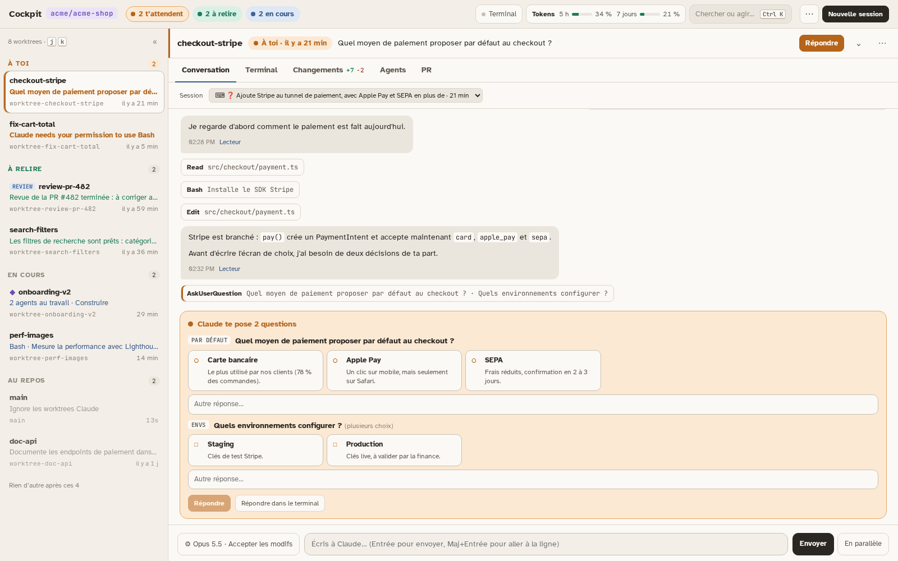

À gauche, chaque worktree est rangé selon ce qu'on attend de toi, pas par ordre alphabétique :

- **À toi** : Claude pose une question ou demande une permission. La plus ancienne vient en premier.
- **À relire** : Claude a fini son tour, il faut regarder le résultat.
- **En cours** : Claude travaille, rien à faire.
- **Au repos** : rien ne se passe.

> « Le matin, Alex ouvre le cockpit. En haut : *2 t'attendent*, *2 à relire*, *2 en cours*. Pas besoin d'ouvrir les terminaux pour savoir où aller. »

Les pastilles en haut sont cliquables, `j` / `k` parcourent la file au clavier.

---

## 2. Répondre sans quitter la page

**Une question.** Sur `checkout-stripe`, Claude a branché Stripe et demande quel moyen de paiement proposer par défaut. La question s'affiche **dans la conversation**, avec les options et leur description. Un clic répond, ou on écrit une réponse libre. Les questions à choix multiples marchent aussi.

**Une permission.** Sur `fix-cart-total`, Claude veut lancer les tests :

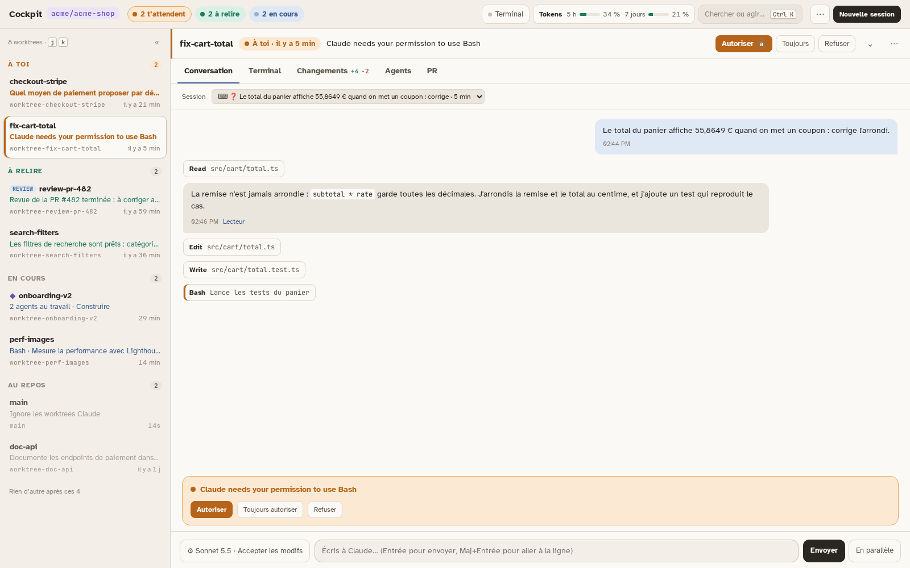

> « Autoriser, Toujours autoriser, Refuser : la touche `a` suffit. Claude repart immédiatement et la session passe en *En cours*. »

---

## 3. Relire ce que Claude a fait

`search-filters` est **à relire** : Claude a terminé et résume ce qu'il a fait.

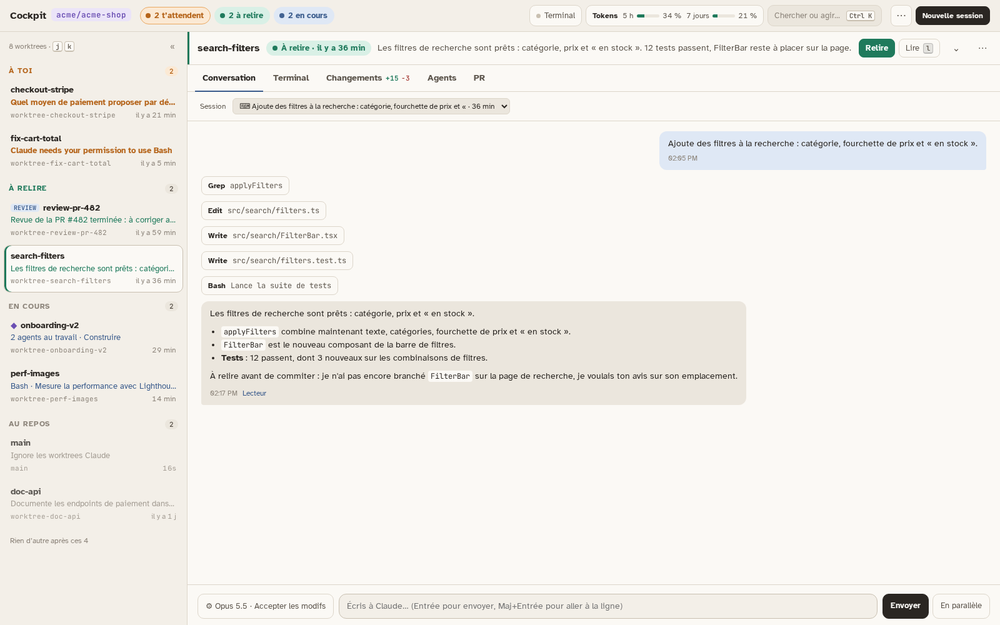

L'onglet **Changements** montre le diff non commité, fichier par fichier, et le compte de lignes `+15 −3` directement dans l'onglet :

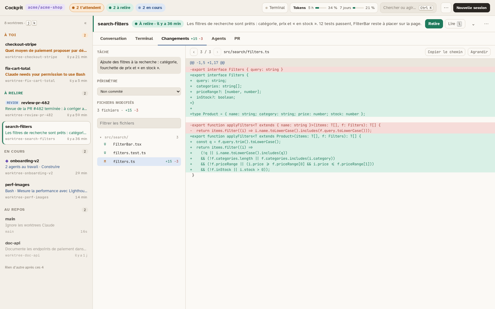

> « On relit comme dans une PR, mais avant même qu'il y ait un commit. Si quelque chose ne va pas, on répond dans le composeur en bas, et Claude corrige. »

---

## 4. Faire relire une pull request

Une session peut être lancée en mode **Review** : on lui donne une PR, elle charge les skills de revue (contexte du ticket, code review, sécurité) et rend un **rapport en blocs colorés**.

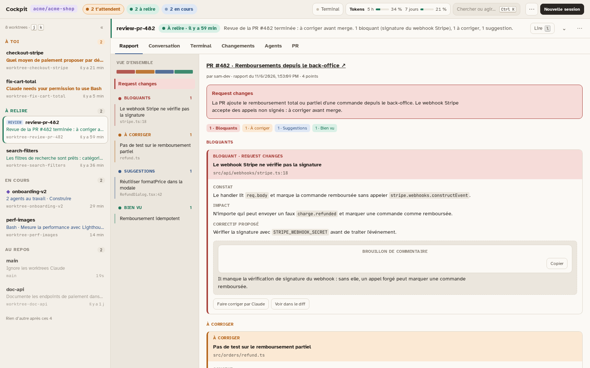

> « Rouge : bloquant. Ambre : à corriger. Bleu : suggestion. Vert : bien vu. Chaque bloc a le constat, l'impact, le correctif proposé et un brouillon de commentaire à copier dans GitHub. Le cockpit ne poste jamais rien tout seul. »

« Faire corriger par Claude » renvoie un bloc à la session pour qu'elle le corrige.

---

## 5. Déléguer un gros chantier : l'orchestration

Pour un travail plus large, on lance un **maître**. Il ne code pas : il découpe le travail en phases, lance des **agents** (de vraies sessions, chacune avec son modèle et son effort), lit leurs rapports et vérifie avant de conclure.

Sur `onboarding-v2`, le maître refait l'onboarding des nouveaux clients :

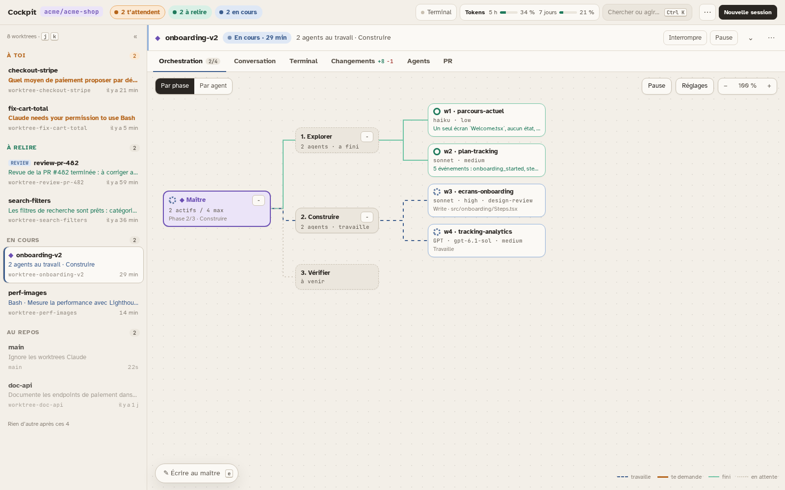

- **Explorer** : deux agents rapides (Haiku, Sonnet) ont cartographié l'existant. C'est fini, en vert.
- **Construire** : Sonnet écrit les écrans pendant que **GPT** branche le tracking analytics. Les deux travaillent en parallèle, en pointillés bleus.
- **Vérifier** : les tests e2e viendront ensuite.

Un clic sur un agent ouvre son détail : son brief, ses réglages, sa conversation, et un champ pour lui écrire directement.

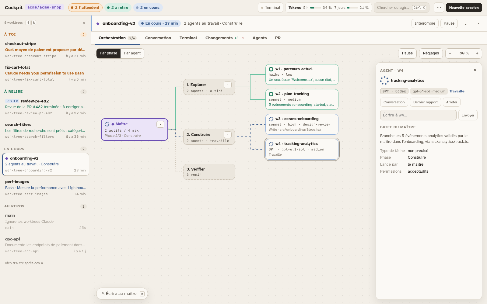

> « Le maître choisit le bon outil pour chaque tâche : un petit modèle pour chercher, un gros pour concevoir, et un autre fournisseur pour relire. Moi, je ne suis sollicitée que si quelque chose bloque. »

---

## 6. Le terminal reste là

Le cockpit ne cache rien : l'onglet **Terminal** est le vrai terminal tmux de la session, utilisable au clavier.

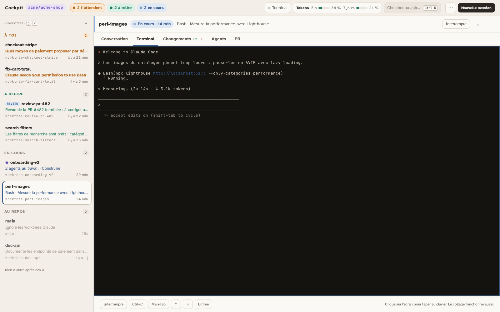

> « Tout ce qu'on fait dans le cockpit, on peut le faire dans le terminal, et inversement. Le cockpit ne remplace pas Claude Code : il le pilote. »

---

## 7. Lancer une nouvelle session

**Nouvelle session** (ou `n`) propose trois types : une session libre (Claude ou GPT), une review de PR, ou un maître. Pour un maître, on règle son modèle, quand il doit nous solliciter, et combien d'agents il peut lancer à la fois.

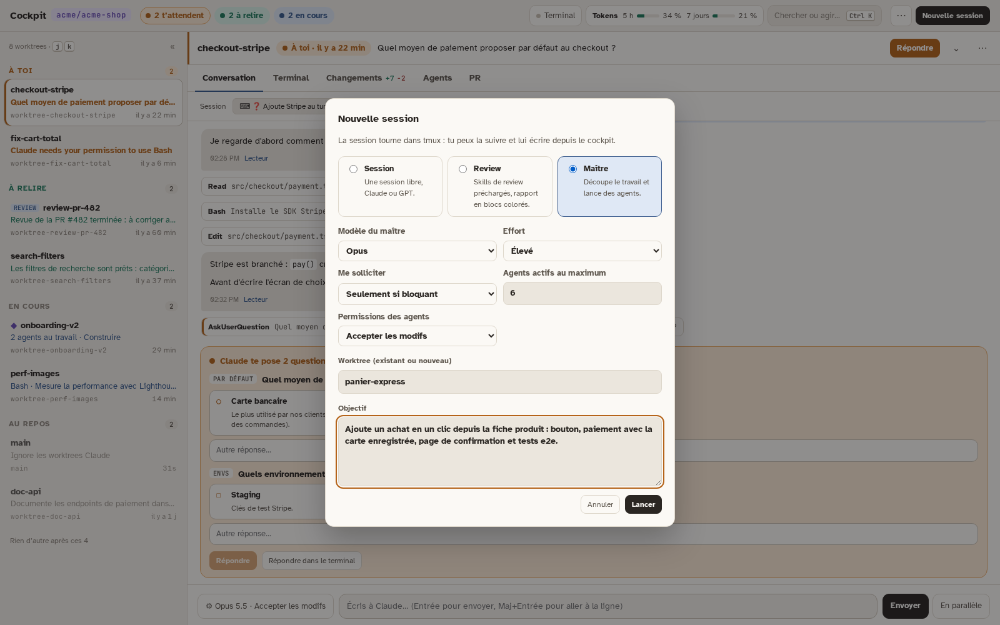

Tout est aussi accessible au clavier avec `Ctrl K` :

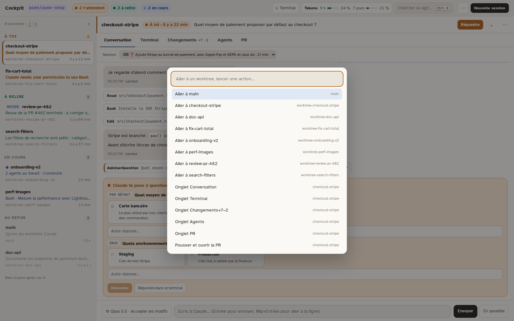

---

## 8. Connexions : Claude, GPT et les serveurs MCP

Une seule page pour se connecter aux deux fournisseurs d'IA et gérer les **serveurs MCP** (Linear, Sentry, Postgres…), valables pour toute l'application.

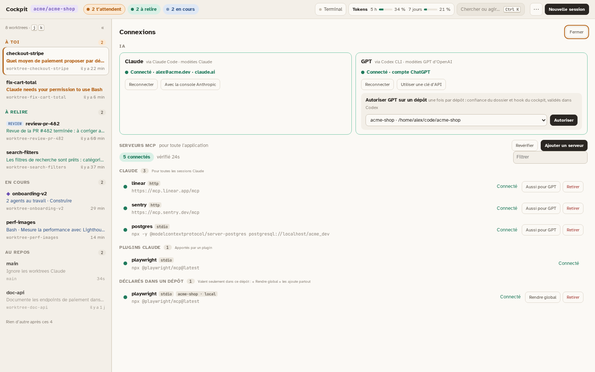

> « On branche un serveur MCP une fois, toutes les sessions en profitent. Un bouton le partage aussi avec GPT. »

---

## 9. La matrice des modèles : quel outil pour quelle tâche ?

Pour chaque type de tâche (explorer, implémenter, déboguer, relire…), la matrice classe les combinaisons fournisseur × modèle × effort. Elle part d'estimations, puis **apprend des notes que les maîtres donnent à leurs agents**.

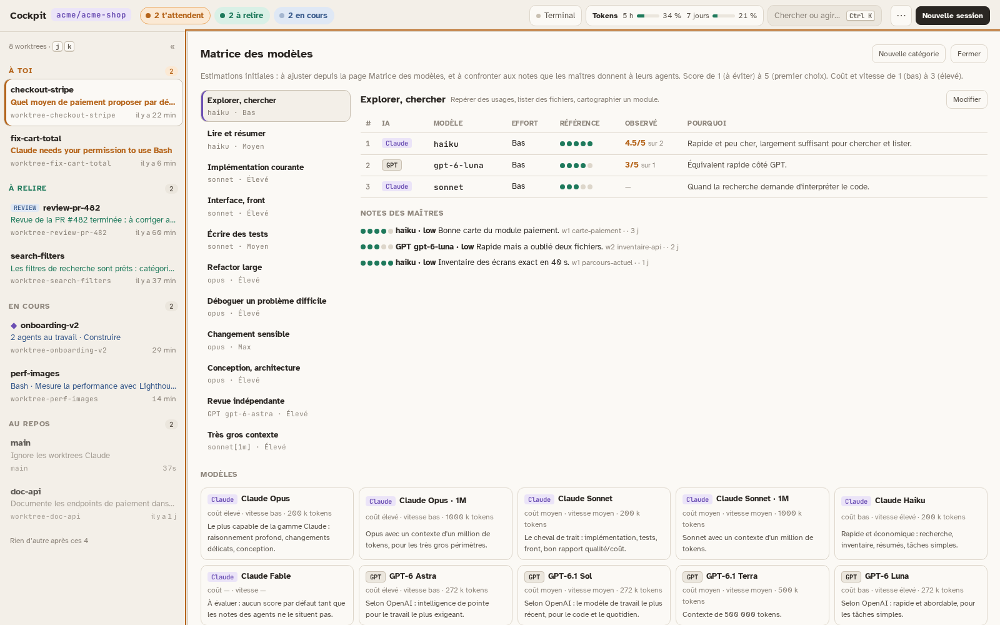

> « Ici, Haiku obtient 4,5/5 en moyenne pour explorer, contre 3/5 pour GPT Luna, qui a oublié deux fichiers. Les prochains maîtres en tiendront compte. »

---

## 10. Pour finir

Le thème sombre, le mode focus (`f` masque la file), et l'ancienne vue en cartes restent disponibles dans le menu ⋯.

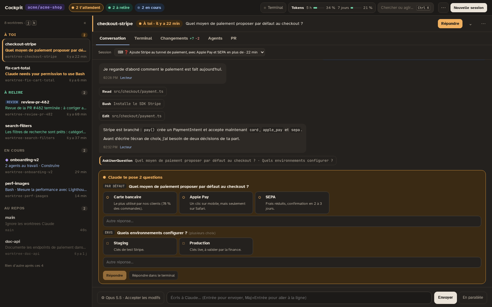

**Le message à retenir :** on lance autant de sessions qu'on veut, et le cockpit dit à chaque instant laquelle a besoin de nous. On répond, on relit, on délègue, sans jamais chercher le bon terminal.

---

## Questions fréquentes

- **Où tourne le cockpit ?** Sur la machine de développement, à côté des sessions. C'est un petit serveur Node sans dépendance ni build, protégé par un jeton d'accès.
- **Faut-il changer sa façon d'utiliser Claude Code ?** Non. Les sessions restent de vraies sessions Claude Code dans tmux, et le cockpit les lit grâce aux hooks.
- **Et si je ferme le navigateur ?** Les sessions continuent. Une boucle de fond suit leurs changements d'état et peut envoyer des notifications sur le téléphone, via ntfy.
- **Est-ce que GPT a les mêmes droits que Claude ?** Chaque dépôt doit être autorisé une fois pour GPT, et ce sont les validations de Codex qui s'appliquent.
